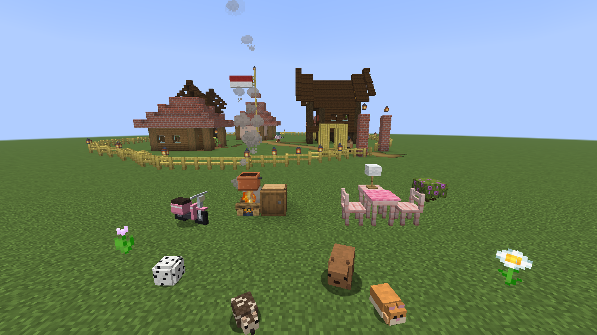

# blossom

**a cozy little minecraft mod, made for two.**

cook together, pet tiny critters, ride a motor through the kampung and play a round of football or badminton.

minecraft 26.3 · fabric · needs fabric api and geckolib

